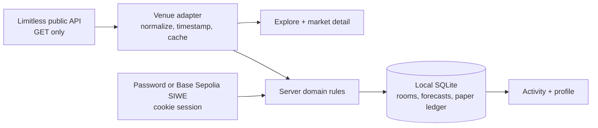

# PREDICT.

**Think in probabilities, not orders.** PREDICT. is a mobile-first prediction app with read-only Limitless market snapshots, free forecasts and a separate paper ledger. An experimental Base Sepolia mode can submit onchain predictions using valueless test tokens. Sign in with a local password, a Base Sepolia wallet signature, or configured Privy email login.

> **Testnet research software, not a real-money trading product.** No live-money execution or production readiness is included. Testnet contracts are unaudited.

## Product preview

The images below are **actual captures from locally running production builds**, not design mockups. Earlier market/room captures used public Limitless reads on 2026-10-29; swipe captures used live Sport venue data on 2026-10-30. Accounts and forecasts shown were created locally. No screenshot depicts an executed venue trade.

<a href="docs/agent/screenshots/landing-desktop.png"></a>

<details>
<summary>Mobile landing and discovery</summary>
<p><a href="docs/agent/screenshots/landing-mobile.png"></a> <a href="docs/agent/screenshots/explore-mobile.png"></a></p>
</details>

<details>
<summary>Live Sport swipe discovery and free forecast confirmation</summary>
<p><a href="docs/agent/screenshots/swipe-sport-mobile.png"></a> <a href="docs/agent/screenshots/swipe-confirm-mobile.png"></a></p>
</details>

<details>
<summary>Market details, paper simulation, and private room</summary>
<p><a href="docs/agent/screenshots/market-mobile.png"></a> <a href="docs/agent/screenshots/private-room-mobile.png"></a></p>
</details>

<details>
<summary>Mobile wallet sign-in and recovery</summary>
<p><a href="docs/agent/screenshots/wallet-auth-mobile.png"></a></p>
</details>

The design uses black, off-white and restrained lavender, bundled **Geist Pixel Square** for display, **Geist Sans** for UI, and **Geist Mono** for metadata. The original ASCII/dither hero is static without WebGL; its gentle animation respects reduced motion. Content scrolls normally on mobile. The AXON attachment was not available in the workspace, so this is an interpretation of the written direction, **not** an exact visual reproduction.

## What works

| Surface | Behavior |
|---|---|
| Landing | Product message, Explore and Rooms actions, read-only live question previews, responsive navigation. |
| Explore | Swipe-first cards and a List alternative; independently paginated live Limitless Crypto, Sport, Esports, Finance and Politics categories. Right/left chooses the first/second **venue-labeled** outcome for review, never saves on gesture; Skip is separate. Loaded-only search/filter, observed timestamps, stale/partial/outage states and retry remain available. Unsupported binary/group mappings are excluded rather than guessed. |
| Market detail | Question, original venue resolution terms, deadline, venue ID, outcome identities, terms version and observed probabilities. Paper action is explicitly separate from forecasting. |
| Accounts and profile | Local password or Base Sepolia EIP-4361 wallet sign-in, separate identities, revocable server-side session, private profile activity, notification preference and sign-out. No wallet or funds are required for the password path. |
| Rooms and forecasts | Public/private shared rooms with owner invitation and membership-checked reads/writes, plus an owner-only personal space created on first free forecast. Confirm a selected venue outcome, chosen probability, reasoning and destination; revisions, historical venue terms and resolution-based scoring persist locally. Free-forecast gestures require confirmation; the separate testnet deck submits the available side on a right swipe after authorization. |
| Activity and notices | Forecast score/correction history, simulated position/settlement history and opt-in in-app notices with read state. |
| Paper simulation | Two-step review and confirmation; locally recorded synthetic shares, outcome, price snapshot and simulated settlement. **Never** a venue fill. |

Loading, empty, stale, error, restricted and resolved states have dedicated UI or explicit messages. Keyboard focus, a skip link, modal Escape/focus return, 320px layouts and reduced-motion behavior were exercised in a browser; see [evidence](docs/agent/EVIDENCE.md).

## Run locally

**Requirements:** Node.js 22, pnpm 12, and network access to the public Limitless API for live discovery. Free forecasting and paper simulation need no API key, signer, contract deployment or paid service. Testnet trading additionally needs a configured Base Sepolia deployment, wallet and funded relayer. Wallet sign-in is optional for free reading: use an EIP-1193 wallet in a browser extension or a wallet's in-app browser supporting Base Sepolia. EOA verification works offline; smart-account verification uses a read-only Base Sepolia RPC (`https://sepolia.base.org` by default, optionally `BASE_SEPOLIA_RPC_URL`).

```bash
pnpm install
pnpm dev
```

Open **http://127.0.0.1:3000**. The development script binds to loopback. `pnpm-workspace.yaml` allowlists native install scripts for `better-sqlite3` and `esbuild`; if your pnpm installation blocks them, explicitly approve only those two packages with `pnpm approve-builds better-sqlite3 esbuild`, then rerun `pnpm install`.

For a local production build, stop the dev server first—Next.js dev and build must not write `.next` concurrently:

```bash
pnpm build
pnpm start --hostname 127.0.0.1 --port 3000
```

To use an isolated local database, set `DB_PATH` to an **absolute SQLite file path** before starting the server. By default, records and sessions persist in `.data/prediction.sqlite`; `.data/` is gitignored. Back up your own database if you need its history. No `SESSION_SECRET` is used: sessions are random tokens whose hashes are stored server-side.

### First-use walkthrough

1. Open **Explore**. Choose a category such as **Sport**; swipe right for the first named outcome, left for the second, or use the visible buttons. **Skip** moves on without saving. Switch to **List** for loaded-question search and filtering. Venue odds are informational snapshots, not offers; inspect the original resolution terms and deadline before continuing.
2. Create a password account or sign in with a supported Base Sepolia wallet signature. Wallet and password identities stay separate. Connecting does not sign a transaction.
3. Confirm a **free forecast**: enter your chance for the selected named outcome and explain why. Save to your private personal space by default, or choose a room you already joined. The server checks fresh venue terms before writing. Activity displays the chosen outcome chance; the internal score stores the first venue token probability (`1 − chosen chance` for the second outcome). A forecast never moves funds. Shared private rooms still require owner invitation.
4. Revise an existing forecast from its room before its market locks; review original venue terms and score corrections in Activity. Interrupted submissions reconcile with Activity before any explicit retry.
5. On an eligible open CLOB market detail, optionally review a **paper-only** position. Confirming records a hypothetical local fill, never a venue order. Enable opt-in notices in Profile if desired.

## Data flow and boundaries



This is one Next.js 15/React 19 TypeScript application. `src/lib/server/venue.ts` reads and normalizes external markets; `src/lib/server/domain.ts` enforces membership, locking, scoring and paper simulation; `src/lib/server/db.ts` owns SQLite schema/migrations. `src/app/api/` contains local endpoints, while `src/components/` and `src/app/(site)/` provide the mobile-first interface. SQLite uses WAL and foreign keys. Tests use isolated temporary databases and mocked external responses; fixtures in tests do **not** establish live venue integration.

### Optional Privy sign-in

Set `PRIVY_APP_ID` and `PRIVY_VERIFICATION_KEY` (the Privy dashboard's PEM public verification key), and enable email login in that Privy app. The server verifies the access token and issues a separate local session. Privy and wallet identities are not linked; existing wallet sign-in remains available. Privy sends authentication data to its service. Without configuration the option is disabled. No live Privy account or embedded-wallet trading has been verified.

### Read-only local analyst

Start Ollama locally with an already installed local model and set `OLLAMA_MODEL` to its name before starting the app, for example `OLLAMA_MODEL=qwen2.5:0.5b pnpm dev`. Signed-in users can request analysis from a market page. The model receives the question, resolution terms, deadline, outcomes and source metadata from the current venue snapshot; it does not browse, execute transactions or settle markets. Its output may be wrong. An unavailable model produces an error rather than a fabricated analysis. Local model use requires local compute and an installed Ollama model.

### Base Sepolia testnet predictions

The **Testnet swipe** view uses `contracts/BaseSepoliaPrediction.sol`, an equal-stake two-party contract with an unrestricted test-token faucet. The deployed Base Sepolia contracts are [prediction contract](https://sepolia.basescan.org/address/0x1E033dB73C4F0a3F689dEB60469cE37B0537B07c), [test token](https://sepolia.basescan.org/address/0x9e92FbF9cD78130a4E08c6a1e121d225567B632B), and [Chainlink ETH/USD feed](https://sepolia.basescan.org/address/0x4aDC67696bA383F43DD60A9e78F2C97Fbbfc7cb1). The deployment uses a 3,600-second maximum price age and an 86,400-second resolution window.

Set `TESTNET_PREDICTION_ADDRESS`, `TESTNET_TOKEN_ADDRESS`, `BASE_SEPOLIA_RPC_URL` and the server-only `TESTNET_RELAYER_PRIVATE_KEY`. The relayer needs test ETH. Local development on the deploying machine has these settings in gitignored `.env.local`, including a plaintext testnet-only relayer key. The deployer's encrypted keystore and its password are stored under gitignored `.data/testnet-deployer/`; restrict access to both. Do not use this key for mainnet or real funds, publish these files, or place the relayer key in client-side environment variables.

Sign in with the same injected Base Sepolia wallet, mint test tokens, and approve a capped allowance and a temporary delegate. A right swipe signs and relays the available side without another wallet prompt; a left swipe skips because the current contract only allows joining the creator's opposite side. This is not a two-direction trading deck. Privy-only sessions cannot yet trade. Pending, confirmed, reverted and unknown states are distinguished, with unknown submissions blocked from retry. Revoke the delegate when finished; its key is unencrypted in tab session storage and revocation does not revoke the token allowance. Setup, mint, market creation, resolution, refund and withdrawal still require wallet transactions and gas.

The Chainlink rule uses the first successful checkpoint within the resolution window with a fresh round updated at or after the deadline, **not** the deadline price. Caller timing can affect the result; absent qualifying data allows refund after the window. Base Sepolia has no verified sequencer uptime feed configured here. `forge test --root contracts --contracts .` exercises the contract locally. This design and code are unaudited and unsuitable for mainnet.

The relayer serializes submissions and persists its nonce and lock in SQLite. Every process using a relayer must share the same `DB_PATH`; do not use multiple independent databases with the same relayer key. An ambiguous broadcast or process crash can leave a durable lock; an operator must reconcile the recorded transaction hash and nonce before clearing it. Never blindly retry an unknown transaction.

### Optional wallet sign-in (Base Sepolia)

Open `/auth`, choose **Continue with wallet**, and approve a **message signature**, not a transaction. Browser wallets are discovered through [EIP-6963](https://eips.ethereum.org/EIPS/eip-6963), with `window.ethereum` as a legacy fallback; when several announce, you must choose one. In a mobile browser without a provider, open the site in a compatible wallet's in-app browser or use the password path. No wallet SDK, hosted account, or external wallet service is silently substituted.

1. The browser requests account access and switches/adds **Base Sepolia (84532)** using [official network details](https://docs.base.org/get-started/connect-to-base.md). It checks `eth_chainId` and the selected account immediately before asking the wallet to sign. A rejected switch or account change leaves sign-in incomplete.
2. The server creates an [EIP-4361 SIWE](https://eips.ethereum.org/EIPS/eip-4361) message with address, actual site origin, chain ID, issue/expiry timestamps and a cryptographically random nonce. SQLite stores its exact text and nonce hash for five minutes; merely connecting creates no account/session.
3. The browser signs the exact challenge with `personal_sign`. The server requires that stored message, origin, address, Sepolia chain and unexpired nonce; it verifies EOA signatures locally through `viem@2.57.13`. Contract-account signatures use chain-checked **read-only** Base Sepolia RPC verification (ERC-1271/6492 via viem). An RPC outage returns an explicit temporary error instead of accepting an unverified smart wallet. One transaction atomically consumes the nonce, finds/creates the separate wallet account, and issues an HttpOnly, SameSite=Lax **one-hour** session. Replay or wrong-origin attempts fail.

Wallet-derived handles have a reserved `w_` namespace. A legacy password user with a colliding handle retains that account; the verified wallet receives another unique handle. Wallet address appears only in the signed-in session, **not** on public profiles. Signing in with a wallet does not access an existing password account; a configured Base Sepolia testnet deployment permits separate test-token actions. Password sessions remain on their original 30-day server-side expiry. There is no wallet linking, recovery for a lost wallet, account-ownership attestation beyond signature control, or public production auth hardening.

### Venue freshness and identity

- Catalog pages use read-only public Limitless category paths and page-by-path endpoints. Binary records missing reliable outcome labels, token IDs or resolution terms, plus group markets, are excluded. Categories paginate independently and All interleaves their eligible questions; a partial category outage is labeled incomplete rather than falsely exhausted.
- Market and outcome IDs, venue slug, deadline, original resolution text, outcome labels and a terms fingerprint are retained. The detail view shows the venue's own terms even when no separate structured resolution-source field exists; forecasts save the displayed original terms independently of the mutable venue cache.
- Visible market screens refresh every 30 seconds. A snapshot older than two minutes or an upstream outage is labeled **stale**; cached questions remain readable with Retry. A partially failing All catalog is labeled incomplete. No fixture is silently substituted for a failed live read.
- A stale, closed or unsupported market cannot create a free forecast or paper position. The server fetches fresh market data and compares the displayed fingerprint before recording a forecast, requiring review on changed terms. Paper actions also re-fetch fresh venue data; browser prices are not executable.

### Free forecasts and resolution

Forecasts only store opinions. For a resolved binary question, the Brier-derived score is `100 × (1 − (p − y)²)`, where `p` is the probability for the **first venue outcome token** and `y` is 1 when that outcome wins or 0 when the second wins. Selecting the second outcome with estimated chance `q` stores `p = 1 − q`; the chosen `q` remains visible in Activity. Revisions are append-only history; corrected venue outcomes create new score-history entries. Split or contradictory outcomes do not receive a binary score. If a later venue observation becomes ambiguous, a prior result is labeled **last confirmed** rather than silently presented as the latest verdict. Legacy forecasts made before original-terms snapshots cannot reconstruct their historical venue labels if the cache has since changed.

### Paper model: `midpoint-v1`

Only an eligible **Limitless CLOB midpoint** can price a paper position. At confirmation, the server records one fresh observed YES midpoint; NO uses `1 − YES`. For a whole-dollar hypothetical stake, **synthetic shares = stake / observed outcome price**. The model assumes an immediate *simulated* fill with **zero fees and zero slippage**. There is no order book execution, reserved balance, exchange fill, custody or transaction hash. Estimated shares and the model/provenance are disclosed before confirmation.

If Limitless later provides an unambiguous payout, local settlement uses its outcome payout numerators and records corrections. An unresolved position remains pending; if a previously settled result becomes ambiguous, its amount is labeled **last confirmed**. Simulated settlements are not realized proceeds or evidence that the venue would have accepted the order. AMM indicated prices are displayed for discovery but **not** eligible for this paper-fill model.

## Verification

```bash
pnpm test
pnpm typecheck
pnpm build
```

The latest local run passed **70 tests across 14 files**, TypeScript checking, and **10 contract tests**. On Base Sepolia, a fresh test wallet completed SIWE, mint, token approval, bounded delegate authorization, a relayed join, receipt confirmation and delegate revocation. The relayed join is [0x08d4…a6e](https://sepolia.basescan.org/tx/0x08d4c1d273ea01927e49dbed90ead83ef5cdb1aec701184bee25e8f3e9106a6e). The deadline and oracle checkpoint had not yet occurred during this verification, so live settlement remains unverified. A local Ollama model returned a market analysis but incorrectly identified the resolution source. Real Privy login and physical wallets were not exercised.

## Network and deployment policy

Limitless data relates to **Base mainnet**, but the app performs **no mainnet writes**. Its testnet mode targets chain **84532** only and is separate from Limitless and paper positions. Test-token transactions were broadcast on Base Sepolia; no real-money order was performed. HTTP success from the relay means submitted, not confirmed.

This repository has **no public deployment configuration**. Running it locally is not permission to redistribute venue data, accept real-money orders, or expose the local password service on the internet.

## Limits before any public launch

- Local password auth has no rate limiting, anti-abuse service, managed backup, production observability or public-host security review. Keep the process bound to loopback.
- Wallet sign-in currently requires an injected EIP-1193 provider; standalone mobile browsers without an in-app wallet cannot initiate it. Physical wallet-extension signing, Coinbase/Base Account smart-wallet signatures and ERC-6492 counterfactual accounts were **not** exercised here. Smart-wallet verification depends on available Base Sepolia RPC; a one-hour cookie limits but cannot eliminate account-control changes before session expiry. Never treat local simulated providers as proof of external wallet interoperability.
- Venue uptime, market schema and geographic/data-redistribution rights require separate verification. The public read-only integration does not prove partner eligibility or a real trading path.
- Scores and paper settlements reconcile during foreground reads; there is no background worker. In-app notices are opt-in only—no push, email or delivery guarantee while the app is closed.
- The screenshots are dated live reads and local demo activity, not evergreen prices or visual fixtures.

## Source revisions

- Base builder guidance and consumer roadmap: [Codex-Claude-Research @ `b1167defe82afd37f1eeda31d6e8b1350c462943`](https://github.com/Zireaelst/Codex-Claude-Research/commit/b1167defe82afd37f1eeda31d6e8b1350c462943). The research repository was **not** copied into this application repository.
- Limitless SDK reference: [`f57d55951ad6c9740387b26b6629ffb03d55fd44` (v1.3.0)](https://github.com/limitless-labs-group/limitless-exchange-ts-sdk/tree/f57d55951ad6c9740387b26b6629ffb03d55fd44), supplemented by the [current public developer docs](https://docs.limitless.exchange/developers/introduction.md). Supported capabilities were evaluated rather than assumed.
- Wallet auth primary sources: [Base Sepolia network](https://docs.base.org/get-started/connect-to-base.md), [Coinbase Wallet authenticate-users](https://docs.cdp.coinbase.com/coinbase-wallet/guides/authenticate-users.md), [EIP-4361](https://eips.ethereum.org/EIPS/eip-4361), [EIP-6963](https://eips.ethereum.org/EIPS/eip-6963), and [viem SIWE verification](https://viem.sh/docs/siwe/actions/verifySiweMessage). Checked 2026-10-30; implementation uses `viem@2.57.13` and the separate research repo revision above.
