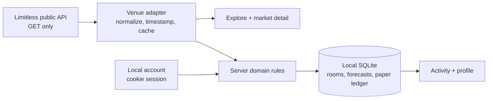

# PREDICT.

**Think in probabilities, not orders.** PREDICT. is a mobile-first prediction app for browsing real market questions, discussing forecasts in rooms, and experimenting with a separate paper-trading ledger. Limitless supplies **public, read-only** market snapshots. The app never sends a venue order, moves forecast funds, or signs a blockchain transaction.

> **Local research software, not a trading product.** No public deployment, real-money execution, custody, oracle, AMM, or live-trading readiness is included.

## Product preview

The images below are **actual captures from the locally running production build**, not design mockups. Market questions and prices came from public Limitless reads on 2026-10-29; they will change. Accounts, room forecasts, and paper positions in the captures were created locally. No screenshot depicts an executed venue trade.

<a href="docs/agent/screenshots/landing-desktop.png"></a>

<details>
<summary>Mobile landing and discovery</summary>
<p><a href="docs/agent/screenshots/landing-mobile.png"></a> <a href="docs/agent/screenshots/explore-mobile.png"></a></p>
</details>

<details>
<summary>Market details, paper simulation, and private room</summary>
<p><a href="docs/agent/screenshots/market-mobile.png"></a> <a href="docs/agent/screenshots/private-room-mobile.png"></a></p>
</details>

The design uses black, off-white and restrained lavender, bundled **Geist Pixel Square** for display, **Geist Sans** for UI, and **Geist Mono** for metadata. The original ASCII/dither hero is static without WebGL; its gentle animation respects reduced motion. Content scrolls normally on mobile. The AXON attachment was not available in the workspace, so this is an interpretation of the written direction, **not** an exact visual reproduction.

## What works

| Surface | Behavior |
|---|---|
| Landing | Product message, Explore and Rooms actions, read-only live question previews, responsive navigation. |
| Explore | Paginated Limitless catalog, loaded-question search and status filter, observed timestamps, live/stale/unavailable labels and retry. Filtering does not claim to search unloaded venue pages. |
| Market detail | Question, original venue resolution terms, deadline, venue ID, outcome identities, terms version and observed probabilities. Paper action is explicitly separate from forecasting. |
| Accounts and profile | Local password account, revocable server-side session, private profile activity, notification preference and sign-out. A wallet is not required. |
| Rooms and forecasts | Public or private room, public join or owner invitation, membership-checked reads/writes, free YES-probability forecasts with reasoning and revision history. |
| Activity and notices | Forecast score/correction history, simulated position/settlement history and opt-in in-app notices with read state. |
| Paper simulation | Two-step review and confirmation; locally recorded synthetic shares, outcome, price snapshot and simulated settlement. **Never** a venue fill. |

Loading, empty, stale, error, restricted and resolved states have dedicated UI or explicit messages. Keyboard focus, a skip link, modal Escape/focus return, 320px layouts and reduced-motion behavior were exercised in a browser; see [evidence](docs/agent/EVIDENCE.md).

## Run locally

**Requirements:** Node.js 22, pnpm 12, and network access to the public Limitless API for live discovery. No API key, wallet, signer, RPC URL, contract deployment or paid service is required.

```bash
pnpm install
pnpm dev
```

Open **http://127.0.0.1:3000**. The development script binds to loopback. `pnpm-workspace.yaml` allowlists native install scripts for `better-sqlite3` and `esbuild`; if your pnpm installation blocks them, explicitly approve only those two packages with `pnpm approve-builds better-sqlite3 esbuild`, then rerun `pnpm install`.

For a local production build, stop the dev server first—Next.js dev and build must not write `.next` concurrently:

```bash
pnpm build
pnpm start --hostname 127.0.0.1 --port 3000
```

To use an isolated local database, set `DB_PATH` to an **absolute SQLite file path** before starting the server. By default, records and sessions persist in `.data/prediction.sqlite`; `.data/` is gitignored. Back up your own database if you need its history. No `SESSION_SECRET` is used: sessions are random tokens whose hashes are stored server-side.

### First-use walkthrough

1. Open **Explore** and inspect a question. Its observed price is an informational venue snapshot, not an offer; read the complete resolution terms and deadline on the detail page.
2. Create a local account under **Sign in**. In **Rooms**, create a public room or a private one. A private-room owner can invite an **existing account** by handle; nonmembers cannot read it or join uninvited.
3. Join or open a room, pick an open live question, enter your **chance of YES** and reasoning, then post a **free forecast**. The stated pick may be NO, but the numeric probability always refers to YES. Revise until the recorded lock time, venue closure, terms change, resolution or loss of fresh venue data blocks revisions.
4. In a supported open CLOB market detail, optionally review a **paper-only** position. Confirming records a hypothetical fill in the local ledger; it neither sends an HTTP venue order nor moves funds.
5. Inspect **Activity** and **Profile** for forecast revisions, paper history and scores. Enable in-app notices in Profile if you want local resolution/correction notices.

## Data flow and boundaries



This is one Next.js 15/React 19 TypeScript application. `src/lib/server/venue.ts` reads and normalizes external markets; `src/lib/server/domain.ts` enforces membership, locking, scoring and paper simulation; `src/lib/server/db.ts` owns SQLite schema/migrations. `src/app/api/` contains local endpoints, while `src/components/` and `src/app/(site)/` provide the mobile-first interface. SQLite uses WAL and foreign keys. Tests use isolated temporary databases and mocked external responses; fixtures in tests do **not** establish live venue integration.

### Venue freshness and identity

- Catalog pages are fetched from public Limitless endpoints, normalized and cached briefly. Incomplete market/outcome identity or missing resolution terms are excluded; filtered records do not prematurely terminate pagination.
- Market and outcome IDs, venue slug, deadline, resolution text and a terms fingerprint are retained. The detail view shows the venue's own terms even when no separate structured resolution-source field exists.
- Visible market screens refresh every 30 seconds. A snapshot older than two minutes, an upstream outage or a failed client refresh is labeled **stale**; cached questions remain readable with a retry action. No fixture is silently substituted for a failed live read.
- A stale, closed or unsupported market cannot create a free forecast or paper position. The server fetches a fresh market again before recording a paper action; browser display prices are not assumed executable.

### Free forecasts and resolution

Forecasts only store opinions. For a resolved binary question, the Brier-derived score is `100 × (1 − (p − y)²)`, where `p` is the recorded **YES** probability and `y` is 1 for YES or 0 for NO. The outcome pick does not redefine `p`. Revisions are append-only history; corrected venue outcomes create new score-history entries. Split or contradictory outcomes do not receive a binary score. If a later venue observation becomes ambiguous, a prior result is labeled **last confirmed** rather than silently presented as the latest verdict.

### Paper model: `midpoint-v1`

Only an eligible **Limitless CLOB midpoint** can price a paper position. At confirmation, the server records one fresh observed YES midpoint; NO uses `1 − YES`. For a whole-dollar hypothetical stake, **synthetic shares = stake / observed outcome price**. The model assumes an immediate *simulated* fill with **zero fees and zero slippage**. There is no order book execution, reserved balance, exchange fill, custody or transaction hash. Estimated shares and the model/provenance are disclosed before confirmation.

If Limitless later provides an unambiguous payout, local settlement uses its outcome payout numerators and records corrections. An unresolved position remains pending; if a previously settled result becomes ambiguous, its amount is labeled **last confirmed**. Simulated settlements are not realized proceeds or evidence that the venue would have accepted the order. AMM indicated prices are displayed for discovery but **not** eligible for this paper-fill model.

## Verification

```bash
pnpm test
pnpm typecheck
pnpm build
```

The last verified run passed **28 tests across seven files**, TypeScript checking and a clean production build. Browser evidence covers live catalog pagination, two-account private-room denial and invitation, posting and revising a free forecast, confirming and reading a simulated position, injected outage/retry behavior, mobile layout, keyboard focus and reduced motion. Resolution, score correction, simulated settlement, ambiguity recovery and notification opt-in are covered by deterministic local tests; **an actual venue resolution was not observed**. Details: [EVIDENCE.md](docs/agent/EVIDENCE.md), [DECISIONS.md](docs/agent/DECISIONS.md), [STATUS.md](docs/agent/STATUS.md).

## Network and deployment policy

Public Limitless market data relates to **Base mainnet**, but the application performs **no mainnet writes**. [Official Limitless developer documentation](https://docs.limitless.exchange/developers/introduction.md) does not offer an official Sepolia venue environment in the evaluated material. Base Sepolia **84532** was the only authorized network for any application onchain writes, but this architecture needs **no** wallet signature, testnet contract, deployment or transaction. None was performed. HTTP success is never reported as a venue fill.

This repository has **no public deployment configuration**. Running it locally is not permission to redistribute venue data, accept real-money orders, or expose the local password service on the internet.

## Limits before any public launch

- Local password auth has no rate limiting, anti-abuse service, managed backup, production observability or public-host security review. Keep the process bound to loopback.
- Venue uptime, market schema and geographic/data-redistribution rights require separate verification. The public read-only integration does not prove partner eligibility or a real trading path.
- Scores and paper settlements reconcile during foreground reads; there is no background worker. In-app notices are opt-in only—no push, email or delivery guarantee while the app is closed.
- The screenshots are dated live reads and local demo activity, not evergreen prices or visual fixtures.

## Source revisions

- Base builder guidance and consumer roadmap: [Codex-Claude-Research @ `b1167defe82afd37f1eeda31d6e8b1350c462943`](https://github.com/Zireaelst/Codex-Claude-Research/commit/b1167defe82afd37f1eeda31d6e8b1350c462943). The research repository was **not** copied into this application repository.
- Limitless SDK reference: [`f57d55951ad6c9740387b26b6629ffb03d55fd44` (v1.3.0)](https://github.com/limitless-labs-group/limitless-exchange-ts-sdk/tree/f57d55951ad6c9740387b26b6629ffb03d55fd44), supplemented by the [current public developer docs](https://docs.limitless.exchange/developers/introduction.md). Supported capabilities were evaluated rather than assumed.
